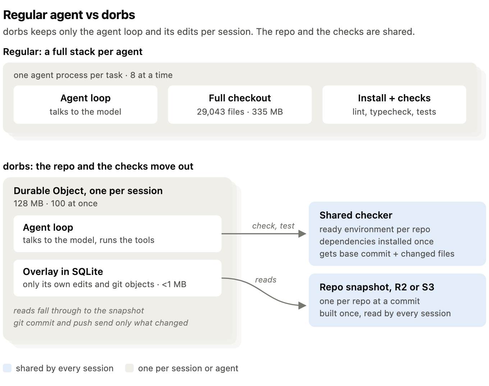
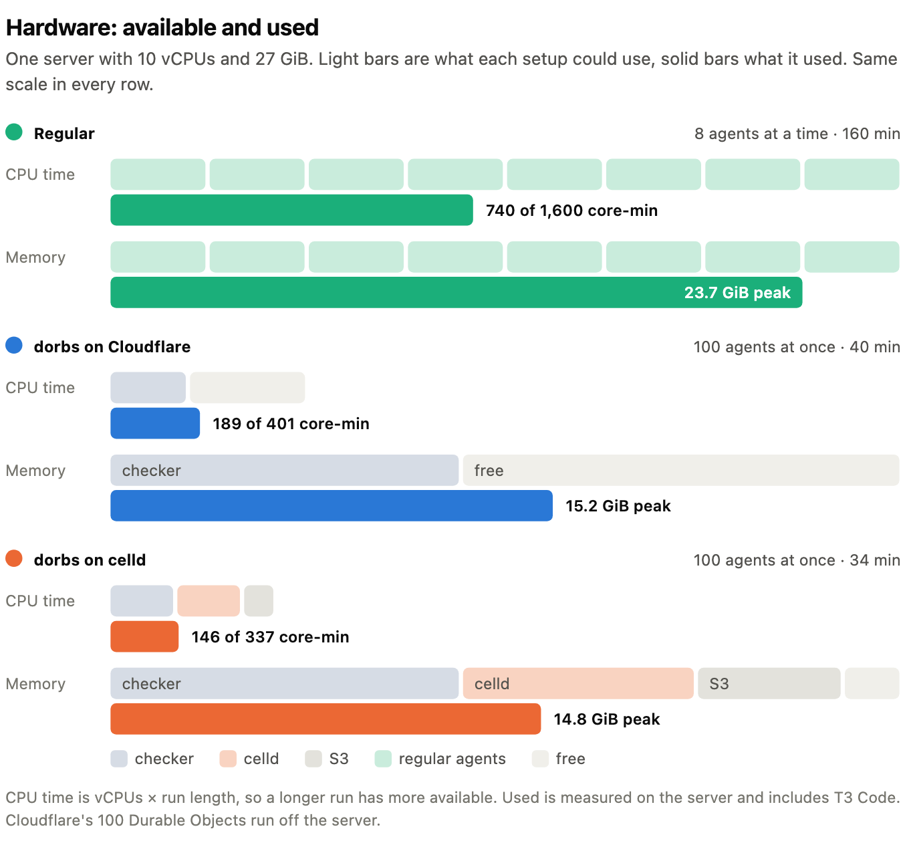
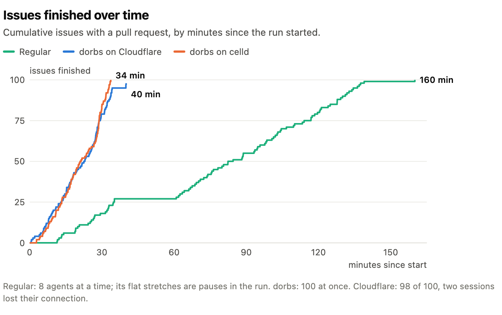
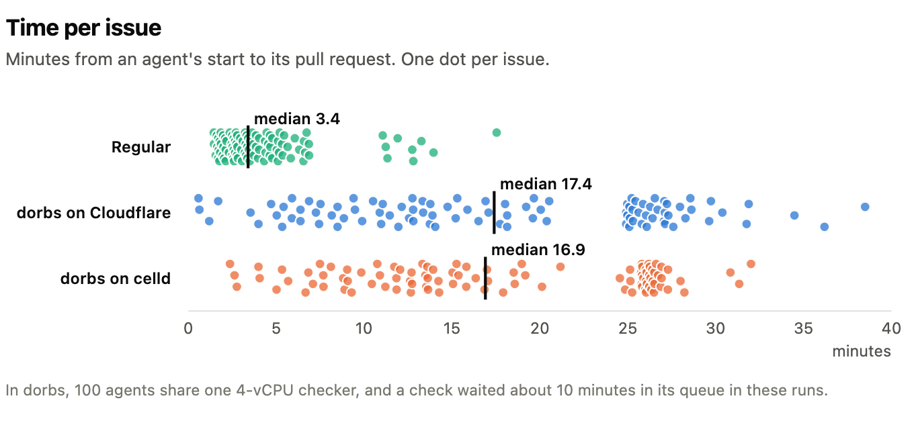
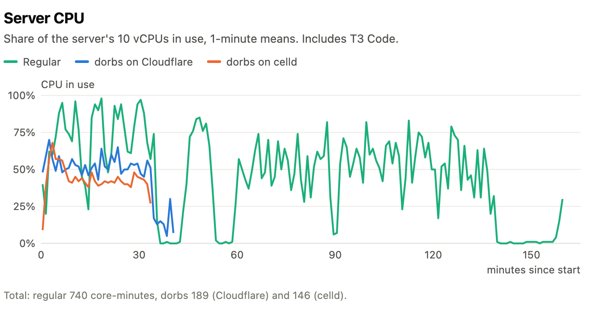

# Don't give every agent a computer

```
This was partly written with AI, Intro and End are written by hand
```

A year from now, you will likely run ten times as many agents as today. You won't have ten times as much memory and compute, though.

So I started with a practical question: what happens when you run a hundred agents at the same time? What does that do to your infrastructure, and how do you make it work?

A standard setup today runs an agent, a full checkout of the repo and a compiler and test suite on one box. This mimics how humans would work and still makes sense if you are running just a few agents at once, but gets very inefficient when you scale up. Agents spend most of their time waiting and reasoning, why should they use memory, disk space or sandbox minutes during that time?

Durable Objects and celld now support Pi Durable and OpenCode and run agents a lot more efficiently, but they don't have a real file system and they can not compile or run verification. For a single agent it makes no sense to build around that, but for 100 it does, so I did, and called it dorbs (hi Amp).

dorbs clones the repo once into R2, gives every agent read access, and provides a shared checker as a tool. I tested it both on Durable Objects on Cloudflare and with celld against a local box. I used a clone of the t3code repo and created 100 small issues for this test. I built an ACP integration to create new threads on dorbs through the t3code MCP server, and used one Opus 5.5 orchestrator thread for each run.

## Taking the agent apart

A coding agent does three jobs. It runs a loop that talks to the model and calls tools. It reads and writes files in the repo. And it runs checks: lint, typecheck, tests.

In a regular setup, all three live inside one checkout, dorbs pulls the three jobs apart and runs each one where it's cheapest.

<picture>
  <source media="(prefers-color-scheme: dark)" srcset="img/architecture-dark.png">
  
</picture>

**The loop runs in a Durable Object, one per session.** If you haven't used one, a Durable Object is a small stateful instance on Cloudflare with its own SQLite storage. An agent spends most of its time waiting for the model, and a 128 MB Durable Object costs very little while it waits.

**The repo is shared.** For each repo at a given commit, dorbs builds one read-only snapshot in object storage, and every session reads from it. When an agent edits files, writes new git objects, or updates branch refs, dorbs keeps only those changes in a small SQLite overlay. In my runs, each session's overlay stayed under 1 MB. Git reads the overlay first and falls through to the snapshot second, so a commit writes only the changed files and a push sends only new objects.

**Checks go to a shared checker.** Instead of installing dependencies in every session, the agent's check and test tools send the base commit and the changed files to a shared checker service. The checker keeps a ready environment per repo, with dependencies installed once. One install serves every agent.

The same code also runs on celld, a self-hosted runtime for Workers and Durable Objects that stores its data in S3. That gave me a second dorbs setup, one that runs entirely on my own server.

## Method

My test repo was a copy of T3 Code, an open-source TypeScript monorepo with 29,043 files (335 MB). I wrote 100 small, independent issues for it. Each agent got one issue and the same instructions: solve it, run the repo's lint and typecheck and fix what they find, then commit on a branch and open a pull request.

Every agent used the same harness, OpenCode, and the same model, DeepSeek v4.1 Flash through OpenRouter. T3 Code started and tracked every thread.

All three setups ran on one server, a VM with 10 vCPUs (Intel i5-13500) and 27 GiB of RAM.

- **Regular.** Each agent has its own git worktree, dependency install, and checks. Eight agents run at a time and share the whole server. At ten, the server ran out of memory.
- **dorbs on Cloudflare.** All 100 agents run at once, each in its own Durable Object, off the server. The repo snapshot lives in R2, Cloudflare's object storage. Checks go to one shared checker on the server, capped at 4 vCPUs and 12 GiB.
- **dorbs on celld.** All 100 agents run at once in celld on the server, capped at 4 vCPUs and 8 GiB. The repo snapshot lives in RustFS, a local S3-compatible store capped at 2 vCPUs and 5 GiB. Checks go to the same shared checker, capped at 4 vCPUs and 12 GiB.

<picture>
  <source media="(prefers-color-scheme: dark)" srcset="img/compute-dark.png">
  
</picture>

## Result

**Wall time.** The regular setup took 160 minutes to get through all 100 issues. dorbs took 34 minutes on celld and 40 on Cloudflare. On Cloudflare, 98 of the 100 issues got a pull request.

<picture>
  <source media="(prefers-color-scheme: dark)" srcset="img/finished-dark.png">
  
</picture>

**Time per issue.** Any single issue took longer with dorbs. A regular agent needed a median of 3.4 minutes from start to pull request. A dorbs agent needed about 17. The checker queue accounts for much of that gap. With 100 agents sharing 4 vCPUs, a check typically sat in line for about 10 minutes. So the time per task can be improved a lot by allocating more resources to the checker.

<picture>
  <source media="(prefers-color-scheme: dark)" srcset="img/per-issue-dark.png">
  
</picture>

**Server load.** Over the full run, the regular setup used 740 CPU core-minutes and peaked at 23.7 GiB of memory. dorbs on Cloudflare used 189 core-minutes of server CPU, since its Durable Objects ran elsewhere. dorbs on celld, with everything on the box, used 146. Both peaked at about 15 GiB. All of these numbers include the T3 Code orchestrator thread, which ran on the same server.

<picture>
  <source media="(prefers-color-scheme: dark)" srcset="img/cpu-dark.png">
  
</picture>

**Cost.** Apart from the server, the only bill dorbs adds is Cloudflare's: $0.48 for 100 sessions, about half a cent per session. On celld, everything runs on the server, so there's no extra bill at all.

**Output.** The pull requests came out similar in size across all three setups, averaging about 1.4 files and 21 to 24 changed lines each.

## Where this fits

This will not replace local agents we talk to, but as we shift into using orchestrator agents that delegate and manage tasks to other agents, this is a great tool to fan out or run lots of small changes in parallel.

In my runs, each dorbs agent took longer mostly because checks queued at the 4-vCPU checker. I expect a bigger checker to close much of that gap, though I haven't tested that yet. I will test scaling checkers on sandboxes next, so the tradeoff between execution time and cost can be a config.

The obvious caveat is that Claude Code is shipped as a binary and can't run on Durable Objects, so no Claude subscription, and subscriptions in general might rate limit you if you are going too hard, but those 100 prs were about 2$ with Deepseek v4.1 flash.
